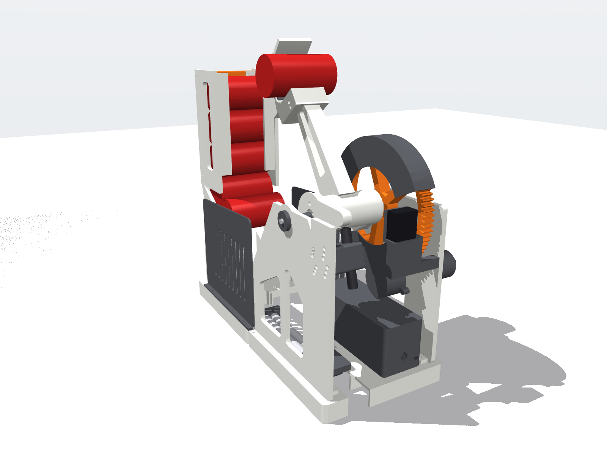

# Beer Button 🍺 — a can launcher you print at home

You press a wireless puck on the sofa. A 3D-printed catapult on the kitchen counter starts beeping and cocks its arm, drops a can from its magazine and lobs it about 4 m to your hands.

The repo is the whole kit:
- research, calculations and simulations
- parametric CAD with STEP, STL and Bambu `.3mf` plates
- firmware for both ESP32-C3 boards, and wiring diagrams
- a bill of materials (BOM) with AliExpress and Amazon.it links
- print, assembly, calibration and safety guides



## Key numbers

<!-- BEGIN:key -->
| | value | target |
|---|---|---|
| BOM, hardware + electronics | **EUR 148.99** (+ EUR 56 filament) | <= EUR 80 (**over**, see REPORT) |
| Print | 3538 g, 93.7 h, 17 plates | fits 256 x 256 x 256 |
| Dispersion at 4 m (calibrated, 1000 shots) | **sd 18.6 cm** (uncalibrated 30.2 cm) | <= 25 cm |
| Catch speed at 4 m | 5.82 m/s (physics minimum 5.8) | <= 4 m/s (**impossible beyond 2.06 m**) |
| Peak height | 1.91 m max | <= 2.3 m |
| Press -> launch | 4 m: 2.42 s, 5 m: 2.86 s | <= 2.5 s (5 m **misses**) |
| Cycle time | 3.5 s | <= 8 s |
| Feed (escapement) | 1500/1500 single feeds | single feed |
| Weakest printed part | SF 2.74: arm (absorber stop 5 m (beam+cup inertia)) | >= 2.5 |
| Button battery | 6.2 months | >= 3 months |
<!-- END:key -->

Two brief targets are missed and are not hidden:
- **The catch-speed target is physically impossible at 4 m.** The minimum is 5.8 m/s.
- **The 5 m latency is 0.3 s over the 2.5 s target.**

The BOM is also over the €80 target. Details are in [KNOWN_LIMITATIONS.md](KNOWN_LIMITATIONS.md).

## How it works

1. **Button:** an ESP32-C3 in deep sleep wakes on the press and sends an ESP-NOW packet signed with HMAC-SHA256, carrying a sequence number to stop replays. Battery life is 6 months on a 500 mAh LiPo.
2. **Launcher state machine:** IDLE → WARN → COCK → FEED → ARMED → FIRE → RESET (and FAULT).
   - **WARN:** the beeper and beacon run for at least 1.5 s before the shot.
   - **COCK:** a 37GB555 gearmotor turns an 80-tooth ring gear. The ring drags the arm back through 90° against three extension springs.
   - **FEED:** at the cocked angle, a servo-driven seesaw escapement releases exactly one can down the chute into the cup.
   - **FIRE:** a second servo trips an over-centre latch. The arm swings 90° in 0.1 s and throws the can, and a hydraulic absorber stops the arm.
   - **RESET:** the ring returns to park for the next shot.
3. **Safety:**
   - A steel safety pin locks the ring and the latch.
   - Real limit switches, stall detection and decock-by-reverse.
   - A self-locking latch, so a power cut never fires.

## Start here

| Step | File |
|---|---|
| 1. Read the rules | [SAFETY.md](SAFETY.md) |
| 2. Order parts | [BOM.md](BOM.md) / [BOM.csv](BOM.csv) |
| 3. Print | [PRINT_GUIDE.md](PRINT_GUIDE.md) and `cad/3mf/plate_*.3mf` |
| 4. Build and wire | [ASSEMBLY_GUIDE.md](ASSEMBLY_GUIDE.md), [electronics/WIRING.md](electronics/WIRING.md), [electronics/PINMAP.md](electronics/PINMAP.md) |
| 5. Flash | [firmware/README.md](firmware/README.md) |
| 6. Dial in 4 m | [CALIBRATION.md](CALIBRATION.md) |
| Why it is this way | [DECISIONS.md](DECISIONS.md), [REPORT.md](REPORT.md) (phase gates), [KNOWN_LIMITATIONS.md](KNOWN_LIMITATIONS.md) |

## Repo map

```
research/      sources (SOURCES.md), physics + parts notes
calc/          hand calculations (python -m calc.run_all -> calc/RESULTS.md)
sim/           MuJoCo launch + feed, Monte Carlo, CalculiX FEA, validation
cad/params.py  every key dimension (change CAN_SIZE = "500" for 500 ml)
cad/src        build123d part code;  cad/{step,stl,3mf,renders} outputs
firmware/      PlatformIO projects: button/, launcher/, shared common/
electronics/   wiring SVGs, pin map, power budget
tests/         pytest gates (make test)
```

## Reproduce

```bash
python3.13 -m venv .venv && .venv/bin/pip install -r requirements.txt   # + CalculiX ccx, g++
make test      # every check: print rules, interference, BOM<->CAD, calc + sim gates, firmware, electronics
make all       # rebuild CAD, re-run calcs and all simulations (~45 min), regenerate docs, test
```

To switch to 500 ml cans, set `CAN_SIZE = "500"` in `cad/params.py`, run `make cad`, and reprint the two `mag_bridge` parts.
